<div align="center">


# Saha CRM

**An offline-first, multi-user field sales CRM for steel trading teams**
*(rebar, steel sheet, coil and profile sales)*

Installable on phones, tablets and desktops · Works without internet in the field · Syncs automatically when back online


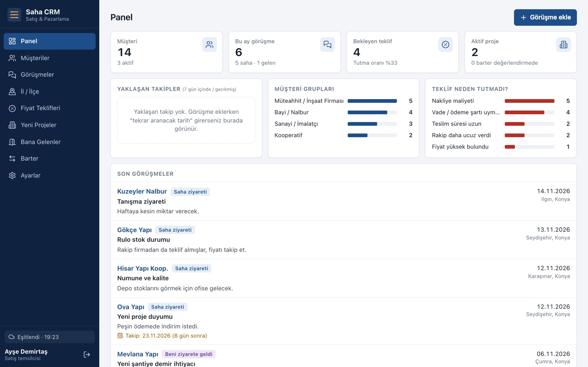

</div>

---

## Table of contents

- [Why this project exists](#why-this-project-exists)
- [Features](#features)
- [Screenshots](#screenshots)
- [Architecture](#architecture)
- [Technical highlights](#technical-highlights)
- [Tech stack](#tech-stack)
- [Getting started](#getting-started)
- [Deployment](#deployment)
- [Using it on a phone or tablet](#using-it-on-a-phone-or-tablet)
- [API reference](#api-reference)
- [Project structure](#project-structure)
- [Roadmap](#roadmap)
- [Türkçe özet](#türkçe-özet)

---

## Why this project exists

Field sales reps at a steel trading company in Konya, Türkiye drive to construction sites, hardware dealers and factories across the province's 31 districts and neighbouring cities. Every visit, every price quote and every *"why didn't we win this deal?"* was tracked in an Excel file. As the customer base grew, that file became hard to search, impossible to use on a phone at a construction site, and invisible to the rest of the team.

**Saha CRM** (*saha* = "field" in Turkish) replaces that spreadsheet with an app built around how field sales in this industry actually works:

- Reps are often **offline** on rural roads and building sites, so the app must work without a connection.
- Prices change daily and deals are lost for specific, recurring reasons: price, a competitor, payment terms, delivery time, freight cost. Capturing **why a quote was lost** is as valuable as recording the quote.
- Customers sometimes pay in kind (**barter**: an apartment or a plot of land in exchange for rebar), which generic CRMs don't model.
- Managers need a **team-wide view** without reps seeing each other's customers and prices.

## Features

### For sales reps
| Area | What it does |
|---|---|
| **Customers** | Contact details, customer group (contractor, dealer, manufacturer…), status, notes. One tap to **call, WhatsApp or open in Maps**. Visit count and "last contacted N days ago" on every card. |
| **Visits & calls** | Log field visits, phone calls and walk-ins ("customers who visited me"). Set a **follow-up date**; due and overdue follow-ups appear on the dashboard. |
| **Price quotes** | Product, spec, quantity, unit price, currency, payment terms. Mark each quote **Won / Lost / Pending**. Lost quotes record the **reason** and the **competitor's price**. |
| **Loss analysis** | Charts of why quotes were lost, helping management spot pricing and logistics problems. |
| **Region coverage** | All 31 districts of Konya plus other provinces: visits per district, last visit, customers per district, planned visits and notes. Shows at a glance which areas are neglected. |
| **New projects** | Track construction projects from first rumour to won or lost, with estimated tonnage. |
| **Barter offers** | Record in-kind offers (apartments, land, vehicles) against product demand. |
| **Quick add** | A floating "+" button on mobile. Typing a new company name while logging a visit creates the customer card automatically. |
| **Exports** | Excel-ready CSV exports (UTF-8 BOM, `;` separator for Turkish Excel) and JSON backups. |

### For managers (admin panel)
| Area | What it does |
|---|---|
| **Team overview** | Per-rep KPIs for a chosen period: customers, visits (field / walk-in), quotes, won/lost, **win rate**, pending quotes, open projects, last visit and last sync. Team-wide loss reasons, quotes by product, most-visited cities. |
| **All records** | Browse every rep's customers, visits, quotes, projects and barter offers. Filter by rep, date range and free-text search. Detail view and Excel export. |
| **User management** | Create accounts with a generated initial password, reset passwords, promote to admin, deactivate. Deactivation **signs the user out on every device** immediately; their records stay in reports. |

### Platform
- **Installable PWA**: home-screen app on iOS and Android, desktop app on Chrome and Edge.
- **Offline-first**: every write goes to the device first and syncs in the background.
- **Responsive**: sidebar on desktop, bottom navigation and bottom-sheet forms on phones, touch-sized controls on tablets.
- **Light and dark mode** follow the OS setting.

## Screenshots

<table>
  <tr>
    <td width="33%">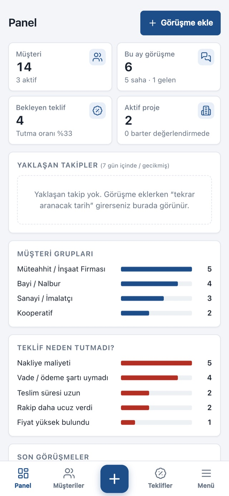</td>
    <td width="33%">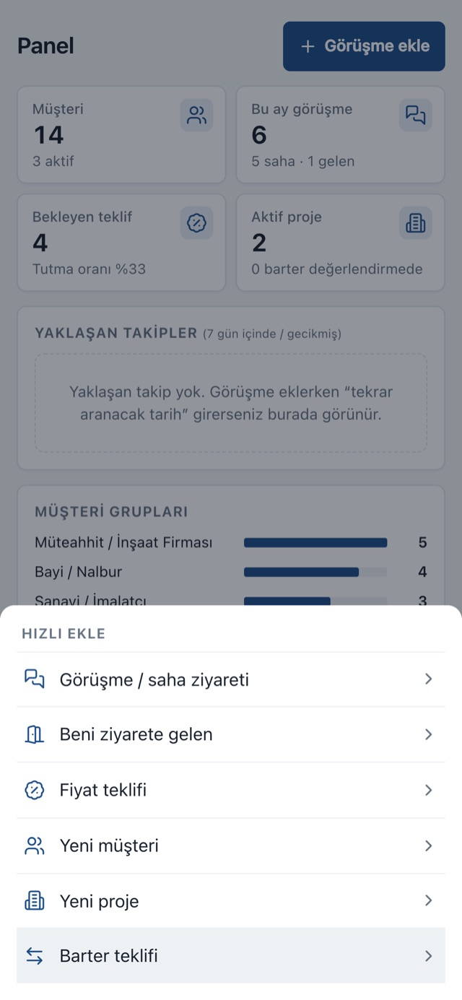</td>
    <td width="33%">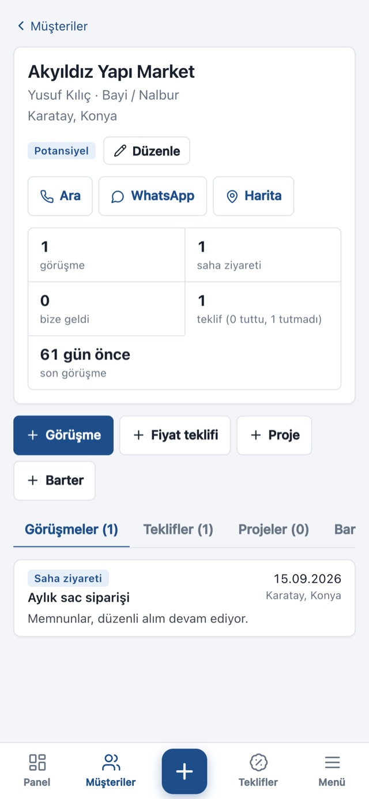</td>
  </tr>
  <tr>
    <td align="center"><sub>Phone: dashboard</sub></td>
    <td align="center"><sub>Phone: quick add</sub></td>
    <td align="center"><sub>Phone: customer card</sub></td>
  </tr>
</table>

| Admin: team overview | Admin: all records |
|---|---|
| 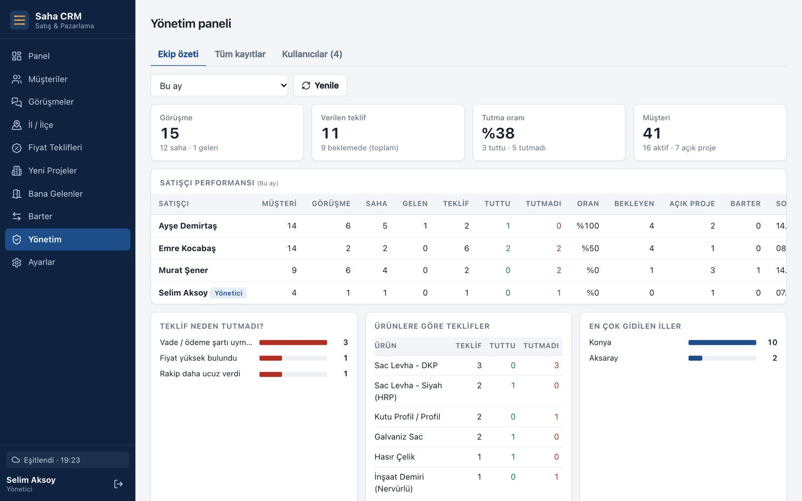 | 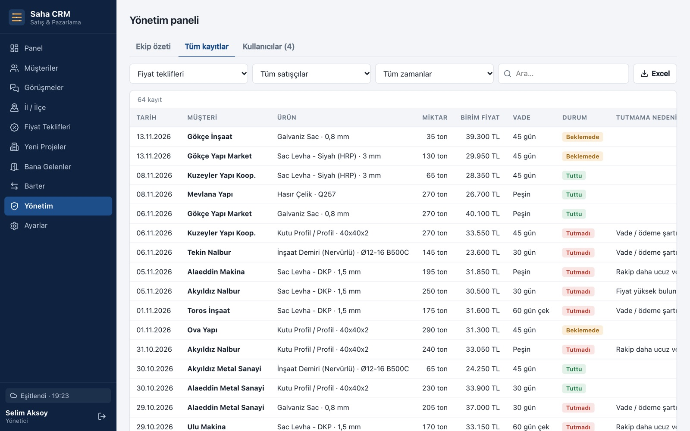 |

| Price quotes and loss reasons | District coverage |
|---|---|
| 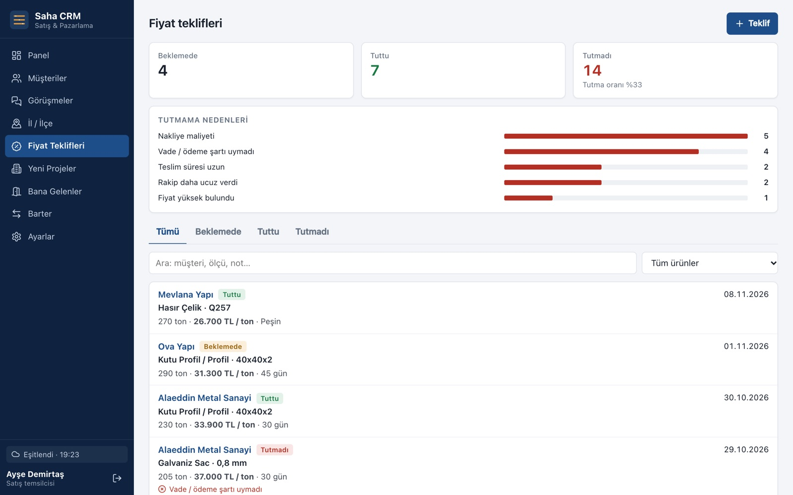 | 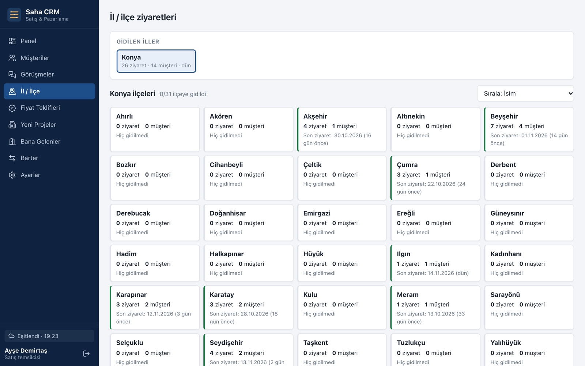 |

| Tablet | Customer detail (desktop) |
|---|---|
| 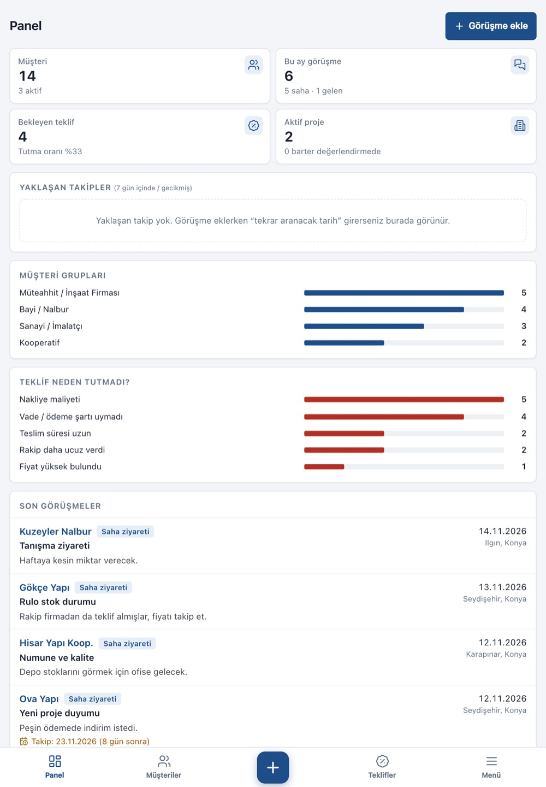 | 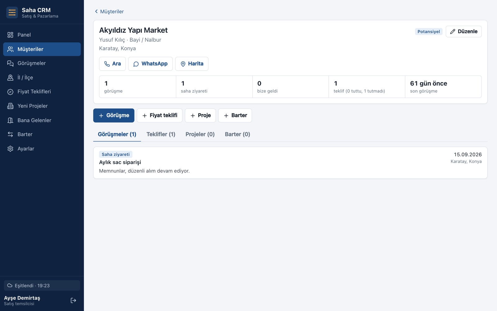 |

<details>
<summary>More screenshots</summary>

| | |
|---|---|
| 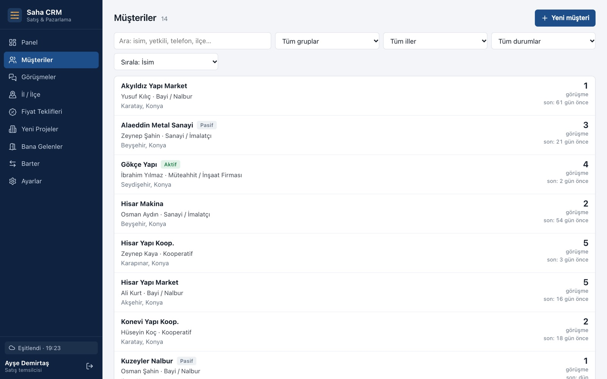 | 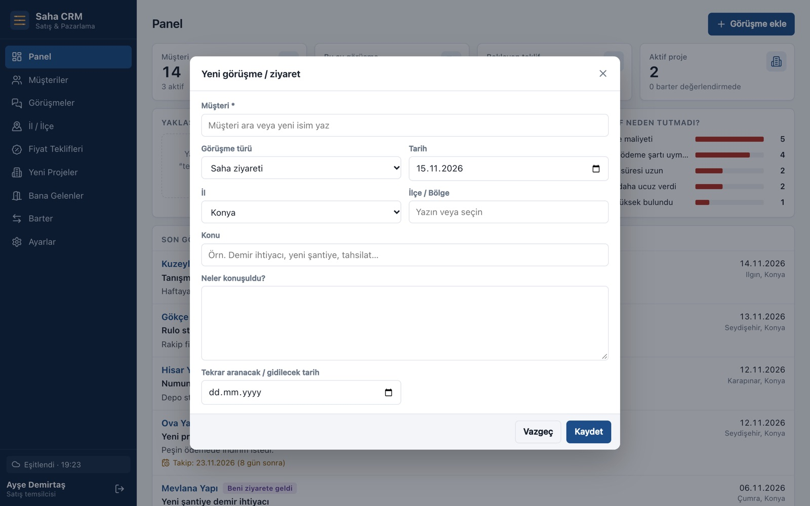 |
| 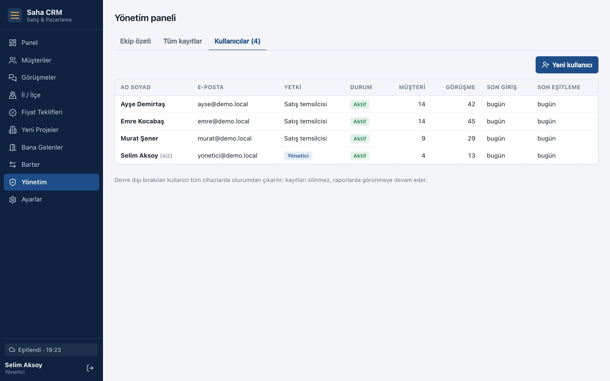 |  |
| 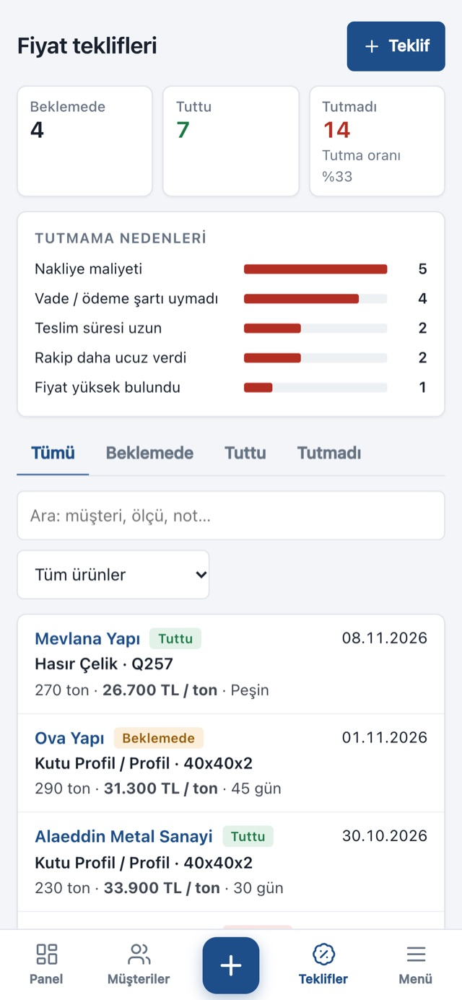 | 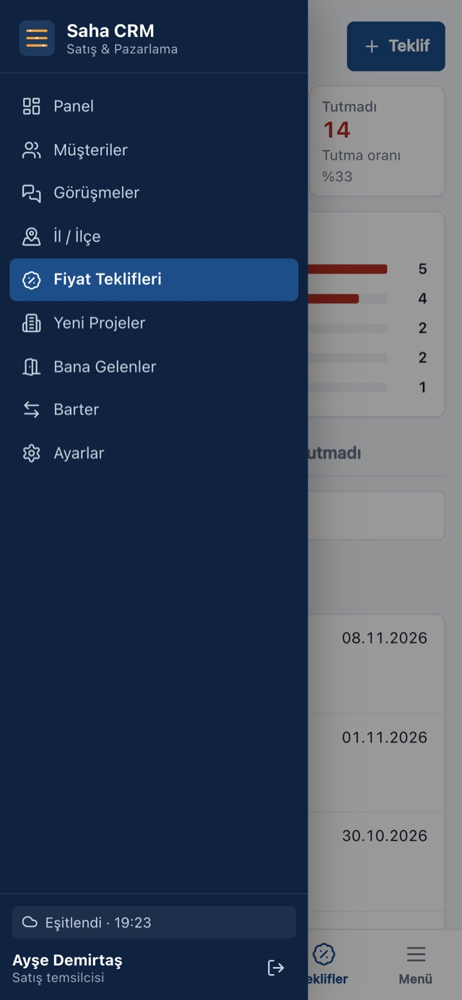 |

</details>

*All screenshots use generated, fictional demo data (`npm run seed:demo`).*

## Architecture

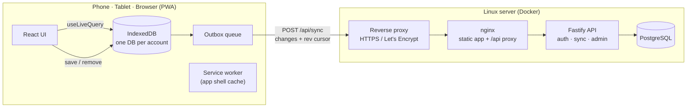

**Read path:** the UI reads only from IndexedDB through Dexie live queries, so screens render instantly and identically online or offline.

**Write path:** `save()` / `remove()` write the record and add an outbox entry in one IndexedDB transaction. A sync runs about 1 second after a change, every 60 seconds, when the tab becomes visible, and when the device comes back online.

## Technical highlights

These are the engineering decisions I'd point to in an interview.

### 1. Offline-first sync protocol ([`src/sync.ts`](src/sync.ts), [`server/src/index.js`](server/src/index.js))
- **Client-generated UUIDs**, so records can be created offline without asking the server for an id.
- **Outbox pattern**: pending changes are stored in IndexedDB, so they survive app restarts and unreliable networks.
- **Global revision cursor**: every server-side upsert takes `nextval('rev_seq')`. A client asks only for rows with `rev > lastRev`, so incremental syncs are cheap.
- **Tombstones**: deletes are soft (`deleted = true`) so other devices of the same user learn about them. A periodic full sync (every 24 hours) reconciles anything missed.
- **Race safety**: each outbox entry carries a sequence number. After a push, an entry is removed only if it wasn't edited again while the request was in flight. Incoming server rows never overwrite records that still have unsent local edits.
- **Per-account local databases** (`saha-crm-u-<userId>`), so a shared tablet never mixes two reps' data.

### 2. Security
- Passwords hashed with **bcrypt**. Sessions are **JWTs in `httpOnly`, `Secure`, `SameSite=Lax` cookies**, so the token is never readable by JavaScript.
- **Token versioning**: changing a password or deactivating a user increments `token_version`, which instantly invalidates every existing session on every device.
- **Data isolation is enforced on the server**: every sync query is scoped to `owner_id = <session user>`, and the client-supplied owner is ignored. Admin endpoints check the role on every request.
- **Input whitelisting**: incoming records are coerced against a typed schema. Unknown fields are dropped and dates, numbers and lengths are validated.
- **Login brute-force throttling** per IP and email.
- Admins **cannot lock themselves out** (no self-demotion or self-deactivation).

### 3. Schema-driven backend ([`server/src/schema.js`](server/src/schema.js))
One `TABLES` definition drives the PostgreSQL DDL (including additive `ALTER TABLE … ADD COLUMN IF NOT EXISTS` migrations), input validation, row↔object mapping and the admin search. Adding a field to a collection is a one-line change.

### 4. Production deployment on a small shared VPS
- Two small containers: **nginx** (about 5 MB RAM) and the **Node API** (about 20 MB RAM, capped at 256 MB). They run next to other services behind an existing **Nginx Proxy Manager** with Let's Encrypt.
- The frontend is **built locally and shipped as static files**, so a server with 1.4 GB of RAM never runs a heavy build.
- The app uses its **own database and least-privilege role** inside a shared PostgreSQL instance. Secrets are generated on the server and never leave it.
- Cache headers are tuned for PWAs: `index.html` and `sw.js` are never cached, and hashed assets are immutable for a year, so updates reach phones right away.

### 5. Domain-specific UX
Turkish locale everywhere (`Intl` number and date formats, Turkish-aware sorting and case-insensitive search). WhatsApp deep links normalise Turkish phone numbers (`0532…` → `90532…`). The customer picker creates new customers inline to keep data entry fast in the field.

## Tech stack

| Layer | Technology |
|---|---|
| Frontend | React 18, TypeScript, Vite, Dexie (IndexedDB) + `dexie-react-hooks`, Lucide icons, hand-written CSS with design tokens (no UI framework) |
| PWA | `vite-plugin-pwa` (Workbox), web app manifest, auto-updating service worker |
| Backend | Node.js 20, Fastify 4, `postgres` (postgres.js), `bcryptjs`, `jsonwebtoken` |
| Database | PostgreSQL 16 |
| Infrastructure | Docker Compose, nginx, Nginx Proxy Manager + Let's Encrypt, rsync-based deploy script |

## Getting started

**Requirements:** Node.js 20+ and Docker.

```bash
# 1. Database
docker run -d --name saha-crm-devdb \
  -e POSTGRES_USER=saha -e POSTGRES_PASSWORD=devpass -e POSTGRES_DB=saha_crm \
  -p 127.0.0.1:55432:5432 postgres:16-alpine

# 2. API (http://localhost:3000)
cd server
cp .env.example .env
npm install
npm run seed:demo        # optional: fictional demo data
npm run dev

# 3. App (http://localhost:5173, proxies /api to :3000)
cd ..
npm install
npm run dev
```

**Demo accounts** (created by `seed:demo`, local only, password `demo1234`):

| Email | Role |
|---|---|
| `yonetici@demo.local` | Admin (sees the whole team) |
| `ayse@demo.local`, `murat@demo.local`, `emre@demo.local` | Sales reps |

To create a real admin account interactively (the password is typed, never passed as an argument):

```bash
cd server && node --env-file=.env scripts/create-admin.js
```

## Deployment

The production setup assumes a Linux server with Docker, an existing PostgreSQL container and a reverse proxy that terminates HTTPS.

```bash
cp deploy/deploy.env.example deploy/deploy.env   # set SERVER=root@your-server
sh deploy/deploy.sh
```

`deploy.sh` builds the frontend, uploads the static files and the API source, creates the database and role on the first run ([`deploy/setup-db.sh`](deploy/setup-db.sh), with secrets generated on the server), then runs `docker compose up -d --build`. Point a proxy host at `saha-crm:80`.

For a fresh server without a reverse proxy, the root [`docker-compose.yml`](docker-compose.yml) shows a standalone setup with **Caddy** and automatic HTTPS.

## Using it on a phone or tablet

1. Open the app's HTTPS address in the phone's browser and sign in.
2. Install it:
   - **iPhone / iPad (Safari):** tap **Share** → **Add to Home Screen**.
   - **Android (Chrome):** tap **⋮** → **Install app**.
   - **Desktop (Chrome / Edge):** click the install icon in the address bar.
3. Launch it from the home-screen icon. It opens full-screen like a native app.
4. In the field, use the **+** button to log a visit, quote, customer, project or barter offer. Without a connection, the status chip shows *"Çevrimdışı · N bekliyor"* (offline, N waiting). Records sync automatically once you're back online.

## API reference

| Method | Path | Auth | Purpose |
|---|---|---|---|
| `POST` | `/api/auth/login` | — | Email and password login, sets the session cookie |
| `POST` | `/api/auth/logout` | — | Clears the session cookie |
| `GET` | `/api/me` | user | Current user |
| `POST` | `/api/me/password` | user | Change own password (signs out other devices) |
| `POST` | `/api/sync` | user | Push `{ since, changes[] }`, receive `{ rev, changes }` |
| `GET` | `/api/admin/users` | admin | List users with activity counts |
| `POST` | `/api/admin/users` | admin | Create user |
| `PATCH` | `/api/admin/users/:id` | admin | Update name, email, role, active flag or password |
| `GET` | `/api/admin/overview?from&to` | admin | Team KPIs, loss reasons, products, cities |
| `GET` | `/api/admin/records/:table?owner&q&from&to` | admin | Search any collection across the team |
| `GET` | `/api/health` | — | Liveness and database check |

## Project structure

```
├── src/                     # React PWA
│   ├── db.ts                # IndexedDB schema, save/remove + outbox, backup import
│   ├── sync.ts              # offline-first sync engine
│   ├── auth.tsx, api.ts     # session handling, fetch wrapper
│   ├── components/          # forms, list rows, UI primitives, sync badge
│   └── pages/               # dashboard, customers, visits, regions, quotes,
│                            # projects, barter, settings, login, admin
├── server/                  # Fastify API
│   ├── src/schema.js        # single source of truth for tables and validation
│   ├── src/index.js         # routes: auth, sync, admin
│   ├── src/auth.js          # bcrypt, JWT cookies, guards, throttling
│   └── scripts/             # create-admin (interactive), seed-demo
├── deploy/                  # nginx, compose, DB bootstrap, deploy script
└── docs/screenshots/
```

## Roadmap

- [ ] Automated tests: sync conflict scenarios (Vitest) and end-to-end flows (Playwright)
- [ ] CI pipeline (type check, build, tests) with GitHub Actions
- [ ] Importing the legacy Excel file directly
- [ ] Push notifications for due follow-ups
- [ ] Shared product price list managed by admins
- [ ] Map view of customers and visit routes

---

## Türkçe özet

**Saha CRM**, Konya'da inşaat demiri, sac, rulo ve profil satan bir firmanın saha pazarlama ekibi için geliştirilmiş, **internetsiz de çalışan, çok kullanıcılı** bir müşteri takip uygulamasıdır. Daha önce Excel'de tutulan müşteri, ziyaret ve fiyat takibinin yerini alır.

- **Satış temsilcisi için:** müşteriler ve gruplar, saha ziyaretleri ve telefon görüşmeleri, "beni ziyarete gelenler", fiyat teklifleri ve **teklifin neden tutmadığı**, Konya'nın 31 ilçesi ve diğer illerde ziyaret kapsamı, yeni projeler, barter teklifleri, takip tarihleri, Excel'e aktarma.
- **Yönetici için:** satışçı bazında performans (görüşme, teklif, tutma oranı), ekip genelinde tutmama nedenleri, tüm kayıtları filtreleyip arama, kullanıcı ekleme, şifre sıfırlama ve devre dışı bırakma.
- **Teknik:** React + TypeScript PWA, IndexedDB ile çevrimdışı çalışma ve otomatik eşitleme, Node.js (Fastify) + PostgreSQL API, httpOnly çerezli JWT oturumları, Docker ile canlı ortam.

Telefona kurmak için iPhone'da **Paylaş → Ana Ekrana Ekle**, Android'de **⋮ → Uygulamayı yükle** adımlarını izleyin.
